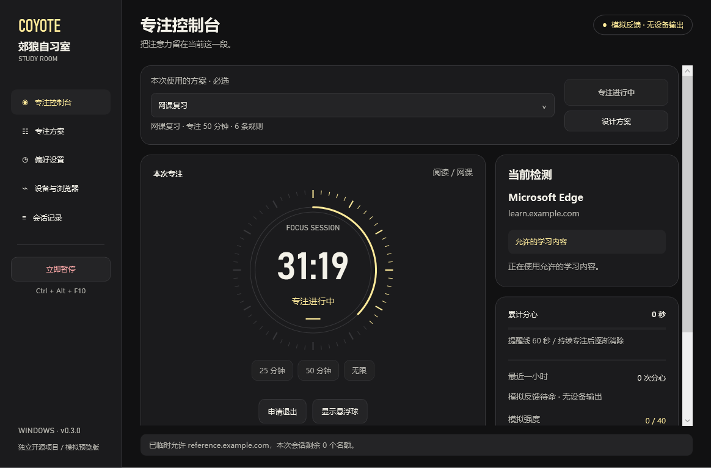
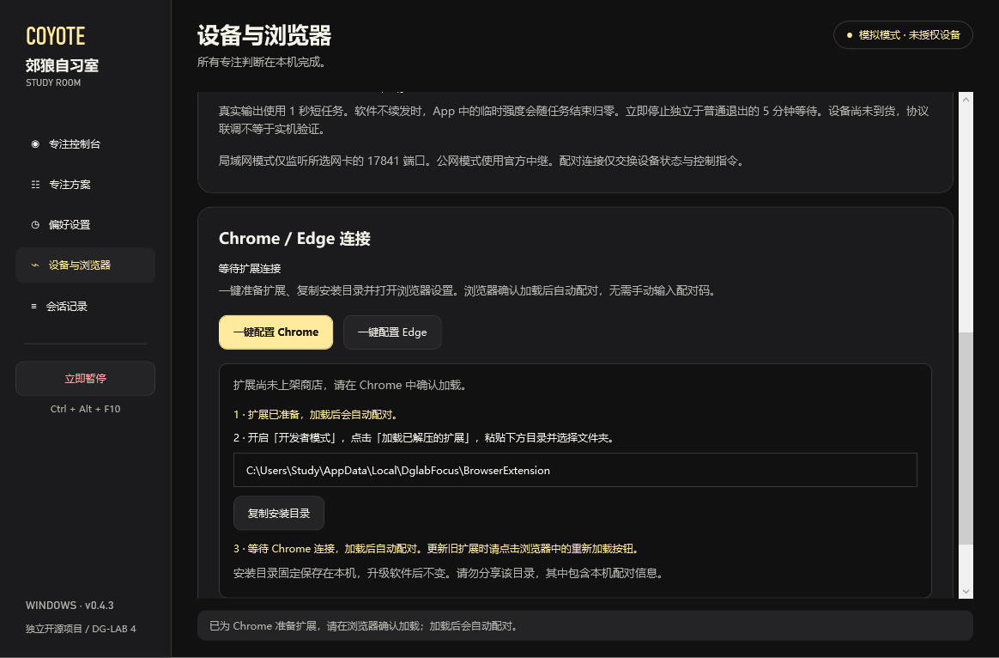
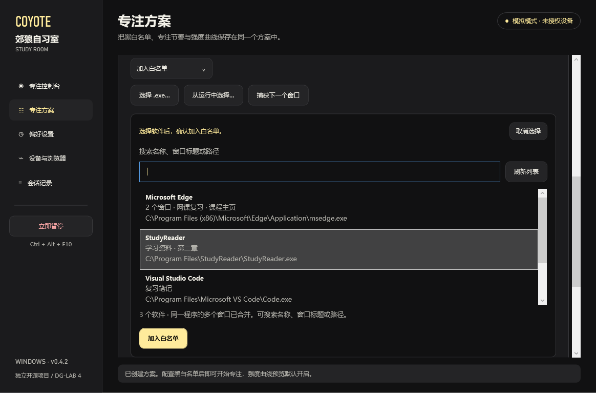
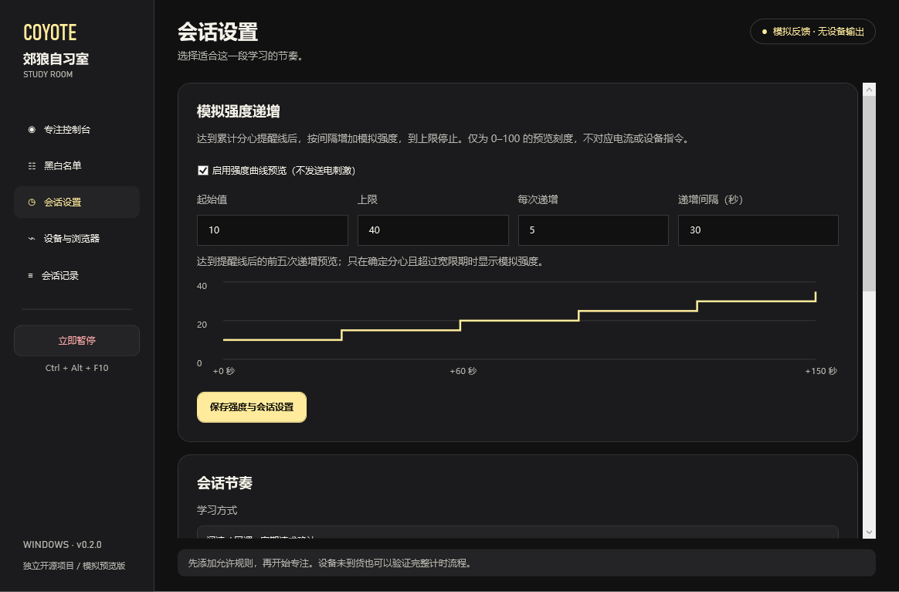

# 郊狼自习室 · dglab-focus

Windows 专注工具。可设计多个方案，每个方案保存自己的软件与网站黑白名单、专注节奏和强度曲线。选定方案后开始复习，软件会检查前台窗口，累计分心时间，并在持续专注后逐渐消除。界面参考 DG-LAB 官网的黑色、浅金色和圆形控制盘，使用原生 Windows 窗口。

支持 **DG-LAB 4 App + 郊狼 3 主机（COYOTE_030）** 的真实 V4 临时强度、波形、清理与清零指令。默认采用模拟模式，真实输出需要在方案内启用，再在设备页手动授权本次通道上限。连接步骤见 [设备接入说明](docs/device-setup.md)。

设备尚未到货。当前通过了本机模拟 App 的协议与 Windows 界面联调，**未完成实体主机实测**。旧版 App、郊狼 2 和其他设备型号不在当前输出支持范围内。

本项目由个人独立开发，与 DG-LAB / Dungeon Lab 无隶属关系。



截图使用示例学习域名。

## 下载

在 [Releases](https://github.com/ShualX/dglab-focus/releases) 下载 Windows x64 压缩包，完整解压后运行 `DglabFocus.exe`。包内带 .NET 运行时，无需单独安装 .NET。

双击包内 `setup/Install.cmd` 可安装到 `%LOCALAPPDATA%\Programs\DglabFocus` 并创建桌面与开始菜单快捷方式，不需要管理员权限。安装新版前请关闭旧版。卸载运行 `setup/Uninstall.cmd`，方案与记录会保留。

当前支持 Windows 10 / 11 x64，开发与渲染检查在 Windows 11 上完成。浏览器扩展需要 Chrome / Edge 116 或以上版本。尚未上架扩展商店，需手动加载。

## 使用

1. 打开「专注方案」，点击「新建」并填写方案名称。在「黑白名单」选择软件与网站各自的模式，添加 `.exe`、域名、具体页面或页面路径。
2. 在方案的「专注节奏」选择电脑复习、阅读 / 网课、纸笔复习。专注分钟设为 `0` 表示无限。「强度曲线」默认开启预览，可调整起始值、上限、递增量和间隔。点击「保存整个方案」。
3. 回到控制台，选择本次使用的方案，点击「开始专注」。未选择方案时启动按钮不可用，菜单也无法启动。悬浮球自动出现，点击展开可申请退出、取消退出、确认学习或立即暂停，也可拖动移动。
4. 普通退出需等待 5 分钟，期间继续复习。`Ctrl+Alt+F10`、主窗口、悬浮球和托盘菜单都可以立即暂停。若全局热键注册失败，界面会提示使用按钮。

固定专注默认 50 分钟，休息默认 10 分钟。默认完成一次专注与休息后结束，勾选循环则进入下一轮。循环、休息和取消退出都属于同一会话。

### 多个专注方案

每个方案独立保存软件与网站的黑白名单、两类名单的默认模式、学习方式、专注和休息时长、确认与恢复参数，以及模拟强度曲线。可以复制一个方案，再调整副本。方案名称可修改，删除后可在本次打开期间撤销最近一次删除。

控制台和方案页的选择保持同步。切换方案或开始专注时，当前有效修改会自动保存。参数无效时保持原方案，修正后再切换。关闭软件前请点击「保存整个方案」保存尚未提交的表单修改。选中的方案和方案库保存在本机，重新打开后恢复。

会话开始后，方案、名单和参数一起锁定。暂停、休息、取消退出或重启都不会切换本次方案。临时查询只影响当前会话，不写入方案库。删除所选方案后不会自动替选其他方案，必须重新选择才能开始下一次专注。

升级时，旧版设置会迁移为「原有专注方案」，默认开启曲线预览，保留已有名单与节奏。第一次启动新会话前需要选择方案。已有会话继续使用原快照，重启后先暂停，确认后继续。

### Chrome / Edge

1. 在软件「设备与浏览器」点击「一键配置 Chrome」或「一键配置 Edge」。软件准备固定安装目录、复制路径，并打开对应浏览器的扩展管理页。
2. 浏览器中启用「开发者模式」，点击「加载已解压的扩展」，粘贴已复制的目录并选择文件夹。这一步由浏览器确认，扩展尚未上架商店，当前无法静默装入。
3. 加载后自动配对，无需粘贴配对码。软件收到所选浏览器的报告后显示连接完成，随后切换到普通网页即可检测。



扩展固定安装到 `%LOCALAPPDATA%\DglabFocus\BrowserExtension`，升级软件后目录不变。再次点击配置可更新扩展文件，浏览器中已加载该目录时需点击扩展的重新加载按钮。若之前从下载包的 `extension` 目录安装过，请先移除旧副本，避免同一浏览器重复上报。

准备目录包含本机配对信息，请勿分享或上传。公开下载包内不包含配对码。手动安装与旧版配对入口保留在折叠区，曾主动设置过的手动配对码优先使用。

Chrome 和 Edge 各加载一次。扩展只报告当前窗口的活动标签页地址与窗口焦点，不读取页面正文、密码或键入内容，不支持无痕窗口。

配置了任何网页规则后，浏览器 `.exe` 放行不会绕过网页规则。扩展断连、报告超过 12 秒、浏览器内部页面或多个浏览器配置文件同时报告前台时，状态视为未知，暂停累计与恢复，模拟强度归零。

### 软件与网站黑白名单

软件和网站分别选择默认模式，两份名单可同时保留：

| 模式 | 白名单命中 | 黑名单命中 | 两者均未命中 |
| --- | --- | --- | --- |
| 白名单模式 | 允许 | 算分心 | 算分心 |
| 黑名单模式 | 允许 | 算分心 | 允许 |

**黑名单始终优先**，同一软件或网站同时命中两份名单时仍算分心。软件按完整 `.exe` 路径匹配，网站支持域名、具体页面和路径规则。只禁止一个网页不会禁止该域名的其他页面，除非另有域名或路径黑名单。

添加软件时，先选择「加入白名单」或「加入黑名单」，再选择来源。「从运行中选择」会列出当前有可读取窗口的软件，同一程序的多个窗口合并显示，可按名称、窗口标题或程序路径搜索。选中后点击名单按钮确认，也可双击列表项或在列表中按 Enter。

「捕获下一个窗口」会等待 30 秒。点击后切换到目标软件，软件会显示对应的程序路径，核对后再加入名单，见[捕获预览](docs/images/app-capture.png)。桌面、任务栏和本软件窗口会跳过。可点击「取消选择」，或回到本软件按 Esc。切换方案、离开规则页、开始专注或等待超时都会取消未完成的选择。仍可用「选择 .exe」添加未运行的软件或无法读取的程序。



窗口标题仅用于内存中的软件选择与搜索，不写入方案和记录。保存的规则始终是完整程序路径，同一路径的大小写变化不会添加重复规则。

Chrome / Edge 的网页按网站模式判断，软件黑名单可以禁止整个浏览器。旧版仅放行浏览器 `.exe` 且没有网页规则的配置继续允许整个浏览器；配置网页规则后逐页匹配。黑名单模式可以从空名单开始，旧配置仍使用白名单模式。

会话开始后，名单和默认模式一起锁定。暂停、恢复和重启不会更换本次会话的匹配规则。

### 模拟强度曲线

在「专注方案 → 强度曲线」配置起始值、上限、每次递增量、递增间隔，以及一小时内重复分心的附加值。曲线使用百分比。新方案默认开启预览，初始为 10%、上限 40%、每 30 秒递增 5 个百分点，每多一次分心另加 5 个百分点。附加值仍受曲线上限约束。

累计分心时间到达提醒线时显示起始值，之后每经过一个递增间隔增加一次，达到上限后保持。计算基于累计分心时间，持续学习使累计时间减少后，相应预览值也会降低。只有确定处于分心状态并超过切换宽限时才显示非零值；回到学习内容、操作面板、状态未知、休息、学习确认、暂停或重启都会归零。

模拟模式只显示曲线。真实模式下，请求强度为 `floor(本次手动设备上限 × 曲线百分比 / 100)`。百分比本身不表示电流。本次设备上限需要手动填写，受 App 当前通道上限约束，软件另限制为 1–100。每次任务最长 1 秒，停止续发后由 App 的任务到期机制归零。



### 临时查询

网站采用白名单模式时，每个专注会话只能新增 **一个域名**，仅本次会话有效，不自动包含子域名。添加后不能替换。已经放行或命中域名黑名单的输入不会占用名额。临时白名单不能覆盖域名、页面、路径或软件黑名单。

网站采用黑名单模式时，未命中的域名已经允许使用，无需添加临时白名单。

休息、循环、取消退出、暂停和重启软件均不重置名额。重启后恢复上次会话时先暂停，确认继续后保留原规则和名额。普通规则在会话中锁定，下一次会话才能修改。

### 分心与无操作

离开允许内容后有 10 秒切换宽限，宽限结束后逐秒累计，前 10 秒不补计。持续分心只计一次，连续回到学习内容 5 秒后才可形成下一次分心。最近一小时次数按实际时间滚动统计，换会话也不会立即清零。

默认累计 60 秒触发屏幕提醒，可选提示音。持续专注 120 秒后，每专注 1 秒消除 0.5 秒累计时间。参数可在会话开始前调整。

电脑模式默认 180 秒无操作后请求学习确认，也可在方案中改为超过无操作时间后按分心计时。后一策略仍不会对未知检测状态累加。阅读 / 网课和纸笔模式默认每 15 分钟确认一次，未确认时只作屏幕提醒。纸笔模式暂停前台窗口判断。

锁屏、睡眠或检测线程停顿超过 5 秒会暂停会话，恢复后需本人确认，不补计停顿时间，也不补发反馈。当前工具不阻止任务管理器结束进程，不以修改系统权限阻止退出。

## 数据与连接

本机设置、当前会话与最近 200 条事件保存在 `%LOCALAPPDATA%\DglabFocus\settings.json`，采用临时文件替换方式保存。前台窗口每秒检查一次，状态每 5 秒保存一次，名额变化等关键操作立即保存。

原子替换时保留 `settings.json.bak`。主文件损坏时尝试从备份恢复，原损坏文件另存保留。两份文件都无效时保留数据并显示读取错误。设备授权和本次硬上限仅保存在内存，重启后不会恢复。

完整网页地址只用于内存匹配，事件不保存浏览历史。记录会保存你主动配置的规则和临时域名。本机配对码也保存在该文件与浏览器扩展本地存储中，请勿公开配置文件。

浏览器桥接通过 Kestrel 只监听 `127.0.0.1:17839`，校验扩展来源和随机配对码，使用普通用户的本机套接字，无需配置 HTTP.sys URL 权限。不连接云端分析服务，不上传专注记录。

DG-LAB 配对默认使用局域网直连：手机与电脑需在同一路由器网络，点击生成二维码后才监听所选私有 IPv4 网卡的 TCP 17841 端口。可选择实际联网网卡，也可复制服务器地址在 App 手动输入。断开或关闭软件会停止监听，不自动修改防火墙或代理。局域网采用明文 `ws://`，用于可信网络。

两端不在同一网络时，可断开后选择官方公网中继 `wss://trex.dungeon-lab.cn/v4`。官方演示中继的可用性由服务方决定。连接只交换配对、设备状态与控制指令，网页地址和专注记录不进入该连接。配对凭证随机生成，仅保存在内存，重新连接后旧二维码失效。详见 [设备连接与故障排查](docs/device-setup.md)。

## 构建和验证

需要 Windows、.NET 8 SDK 和 Node.js 22。运行时与二维码依赖来自 NuGet，首次构建需要联网。

```powershell
dotnet build src/Focus.Windows/Focus.Windows.csproj -c Release
dotnet run --project tests/Focus.Core.Tests -c Release
dotnet run --project tests/Focus.Windows.Tests -c Release
node --test tests/extension.test.js tests/extension-background.test.js
powershell -ExecutionPolicy Bypass -File scripts/package.ps1
```

旧版程序正在运行时，可给打包脚本传入 `-OutputDirectory D:\temp\dglab-focus-0.4.2`，将新版放到独立目录，避免写入被占用的文件。

运行界面渲染检查，不读取或写入个人设置、不连接设备：

```powershell
.\src\Focus.Windows\bin\Release\net8.0-windows\DglabFocus.exe --smoke-test --capture-dir D:\temp\dglab-focus-ui
```

当前验证覆盖 64 项核心测试、77 项 Windows 集成检查和 14 项扩展测试。扩展配置检查覆盖固定目录更新、私有配对配置、非本项目文件保护、浏览器启动参数及自动认证。扩展后台在模拟 Chrome API 和 WebSocket 的环境中执行，验证桥接确认前不会误报连接成功。软件选择、局域网配对、模拟 App 的控制协议与原有功能另有回归检查。手机实际配对、实体主机和用户浏览器内的加载确认仍待实测。

## 结构

`src/Focus.Core` 保存规则、会话、百分比曲线和 V4 操作编码。`src/Focus.Windows` 提供 WPF 界面、Win32 检测、浏览器桥接和 DG-LAB V4 控制器。输出续发独立于界面运行，使用有限时长任务和运行时授权。`extension` 是 Manifest V3 扩展。协议实现独立编写，没有引入官方 GPL SDK 代码或内置波形资源，项目代码继续采用 MIT 许可。

## 参考与许可

[官方 DGLAB KIT 文档](https://github.com/dungeonlab-open/dglab-kit)与 [Win32 前台窗口 API](https://learn.microsoft.com/en-us/windows/win32/api/winuser/nf-winuser-getforegroundwindow)用于核对接入方式。类似项目的调研记录见 [docs/research.md](docs/research.md)。本项目代码采用 MIT 许可，第三方组件说明见 [THIRD_PARTY_NOTICES.md](THIRD_PARTY_NOTICES.md)。
