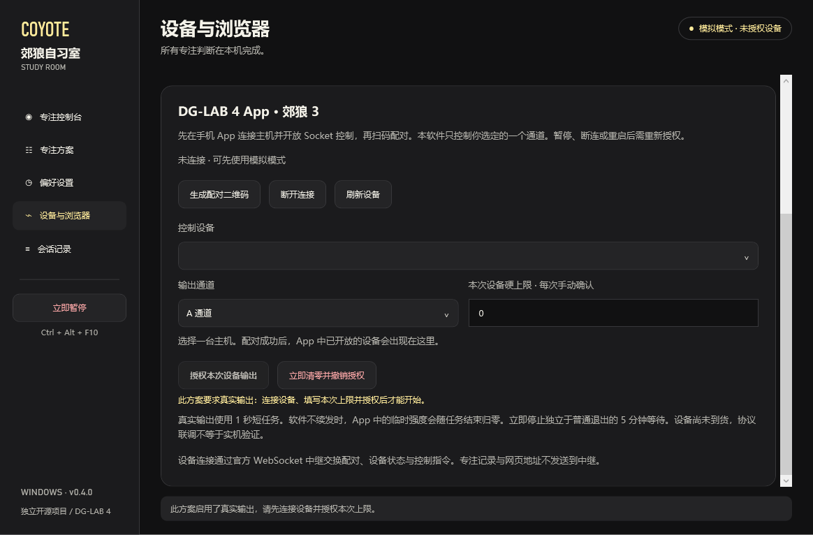

# DG-LAB 4 App + 郊狼 3

本版支持 `COYOTE_030`，通过手机 App 连接主机。软件使用 V4 WebSocket 中继，不直接连接蓝牙。设备尚未到货，现已完成本机模拟 App 与 Windows 界面的协议联调，实体主机仍需实测。

## 首次连接

1. 手机与电脑连接同一路由器网络。电脑用网线、手机用 Wi-Fi 也可以。在软件「设备与浏览器」保留「局域网直连」，选择实际联网网卡的 IPv4 地址。不要选 VMware 等虚拟网卡。
2. 点击「生成配对二维码」，用 DG-LAB 4 App 的 Socket 控制入口扫码。二维码 5 分钟内有效。扫码连接与蓝牙主机连接是两个步骤，没有主机也能先验证手机配对。若 Windows 询问防火墙权限，请允许专用网络。
3. 在手机 App 中连接郊狼 3，并在 Socket 连接中开放对应设备控制。先在 App 中确认所用通道与当前适用的上限。软件设备列表会显示已开放的主机，没有设备时可点击「刷新设备」。
4. 在「专注方案 → 强度曲线」勾选「此方案使用真实设备反馈」，保存方案。
5. 在设备页选择主机和 A / B 通道，手动填写本次设备上限，再点击「授权本次设备输出」。软件先清理旧任务并清零，此时尚不产生输出。
6. 在方案的「专注节奏」设置「分心启动延迟」（默认 10 秒，1–300 秒），回到控制台开始专注。真实方案未授权时不能开始。确定处于分心状态且连续满设定时间后，软件就下发当前曲线对应的指令，无需累计到 60 秒。等待期间不计入累计，累计分心只用于递增强度。

允许的页面或软件中，默认 5 秒无键鼠操作后也会开始分心倒计时，再满启动延迟才输出。默认共需 15 秒。恢复操作后停止本次倒计时和输出，保留累计分心；无操作阈值与处理方式可在方案内调整。纸笔模式不执行无操作计分。

曲线表示手动上限的百分比。例如手动上限为 20、曲线为 40% 时，请求值为 8。软件向下取整，不调整 App 中的舒适上限。手动值不能超过 App 报告的通道上限，软件另限制为 1–100。

## 停止与恢复

每次临时强度和波形任务最长 1000 毫秒，约每 600 毫秒续发。波形使用按公开协议独立构造的均匀 V3 帧，不包含官方 SDK 的波形资源。

回到允许内容、操作专注面板、休息或等待学习确认时，请求值归零并清理当前任务。立即暂停、撤销授权、App 无响应、蓝牙断开、通道异常、App 上限降低和检测不再更新时，停止续发并撤销授权。App 无法返回停机确认时，软件会提示在手机检查通道，最后的短任务仍按 App 的任务到期机制结束。

普通模式退出需等待 5 分钟，期间继续复习。狠心模式锁定普通提前退出和休息，到固定专注时长结束后自动完成。主界面「立即停电」和设备页的「立即清零并撤销授权」始终可用，会撤销授权并紧急暂停，不受退出等待或狠心模式限制。真实方案暂停后需重新授权再继续，重启和重连也不会自动恢复授权。

主窗口顶部及悬浮球同步显示当前请求强度。例如 `3 / 20` 表示当前请求值 3、本次手动上限 20，并标明通道。它跟随设备控制器发出的请求更新，不代表测得的电流。预览百分比在模拟模式下单独显示，真实方案未授权时标明「待授权」。

## 常见情况

App 显示「该二维码/服务器地址连接失败」：这条提示不能区分公网中继不可用、网卡选错或手机无法访问电脑。先安装 v0.4.1 或更新版本，选择局域网直连，重新生成二维码。旧二维码不能沿用。

局域网仍连接失败：检查选中的地址是否属于实际联网网卡，手机是否连接访客 Wi-Fi，路由器是否隔离设备，以及 Windows 防火墙是否允许软件在专用网络接收连接。VPN 或代理需要允许局域网访问。网卡地址改变后请点击「刷新网卡」再生成二维码。本软件不会自动修改防火墙、代理或路由器设置。

扫码识别失败：点击二维码右侧「复制服务器地址」，在 App 的服务器地址框中手动输入该完整 `ws://.../v4?tid=...` 地址。该地址含随机配对凭证，不要公开。断开、重新生成或未配对满 5 分钟后，旧地址失效。

手机与电脑不在同一网络：断开后可切换「官方公网中继」。两端都必须能访问 `wss://trex.dungeon-lab.cn/v4`。软件显示 HTTP 504 等状态码时，应先处理网络或中继可用性。官方演示服务不保证连接稳定，见 [官方演示页](https://trex.dungeon-lab.cn/)。

设备列表为空：确认主机已在手机 App 中连接，并在 Socket 连接中开放对应设备控制。

授权按钮不可用：先保存启用真实反馈的方案，选定设备与通道，填写大于零的本次上限。静音、过热、断开或未知状态不能授权。

授权后没有输出：查看本次方案、连续分心启动倒计时、曲线百分比与当前请求值。累计为 0 不阻止启动，但百分比乘以上限后不足 1 时，向下取整为零。阅读与纸笔确认期间不产生反馈。回到允许内容即停止当前输出，再次分心需重新等待启动延迟。

旧版 App 或其他主机：本版不发送输出指令，仍可使用模拟专注功能。

## 局域网服务

只有点击生成二维码后才启动，监听所选私有 IPv4 网卡的 TCP 17841 端口，不监听所有网卡。电脑控制端只接受本机连接，手机需持有随机 192 位配对凭证，最多连接 4 个 App。中继仅按 [公开 V4 消息协议](https://github.com/dungeonlab-open/dglab-websocket-server/blob/main/README_CN.md#v4-协议)转发消息，不解析设备指令。断开按钮与关闭软件都会停止局域网服务。

局域网使用明文 `ws://`，适用于可信的家庭网络。二维码和服务器地址只保存在内存，不写入配置或事件记录。连接不包含网页地址与专注记录。
